

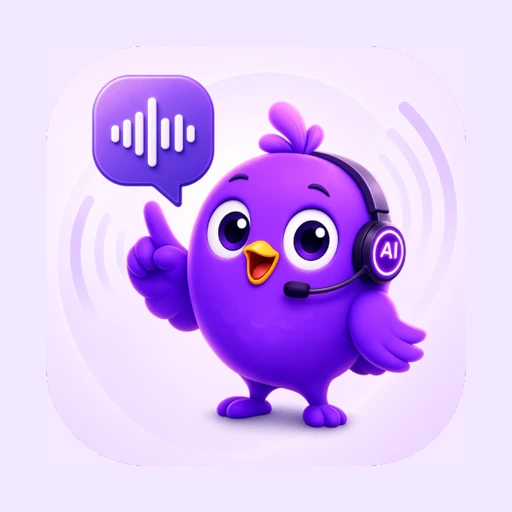

# Fluentta AI

**An English-learning Flutter app that pairs a large bundled curriculum (CEFR-structured lessons and scripted roleplay) with AI conversation, cloud pronunciation checks, and on-device text-to-speech — while keeping provider credentials on a Firebase-hosted proxy.**

**Android · iOS** 
Flutter · Dart · Provider · SharedPreferences · Firebase · Cloud Functions

<table>
  <tr>
    <td align="center">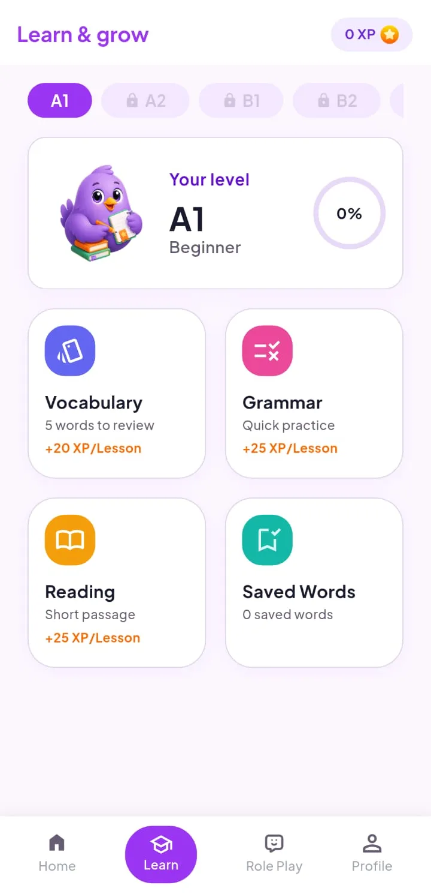</td>
    <td align="center">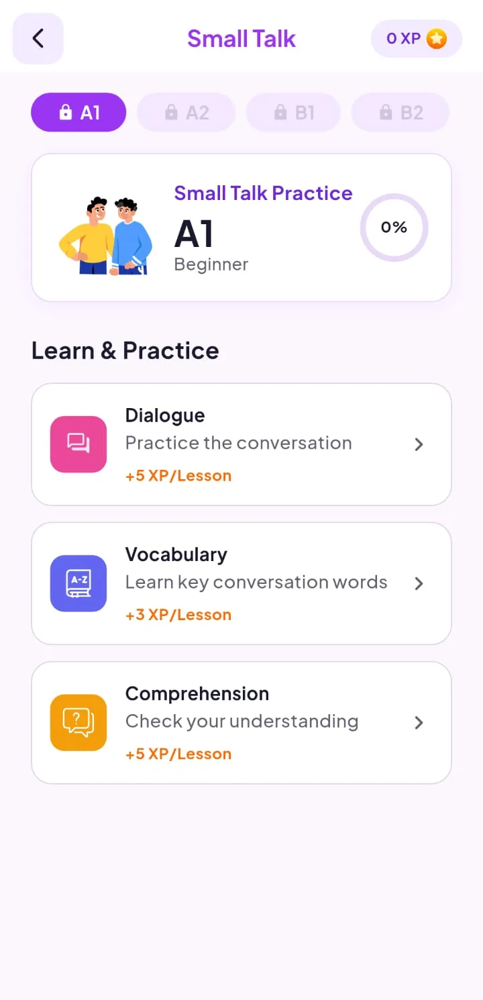</td>
    <td align="center">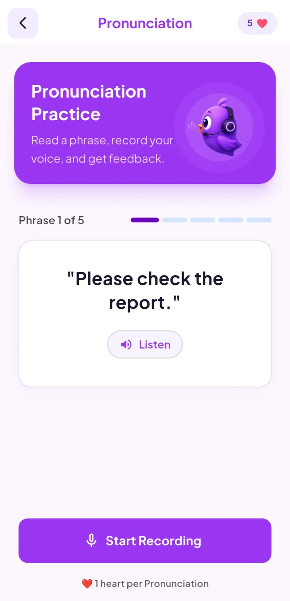</td>
  </tr>
</table>
Real screenshots from the Android build, cropped to the app content (system status bar and ad-placeholder strips removed), captured with sample/placeholder data, metadata removed.

---

## Availability

**Fluentta AI is not currently publicly released.** There is no store listing to download from at the time of this write-up. This repository is an engineering portfolio only.

The app is a language-practice tool. It does not issue certificates, score official exams, or replace classroom instruction or professional language assessment.

## The Idea in One Picture

Most of the product runs from bundled JSON lessons and roleplay scripts on the device. AI enters where open-ended practice is needed: typed or spoken chat with gentle corrections, pronunciation scoring from uploaded audio, on-demand vocabulary translation into the learner's app language, and voice transcription for chat. Every cloud AI call goes through HTTPS functions that verify the signed-in user's identity token before calling a third-party language-model and speech API.

  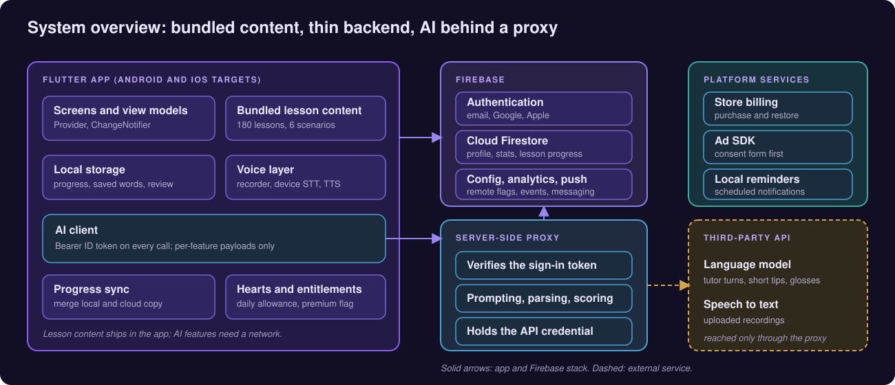

## Product at a Glance

| | |
|---|---|
| **What it is** | English practice: vocabulary, grammar and reading lessons; six roleplay scenarios; open AI chat; pronunciation checks with per-word feedback |
| **Curriculum** | 180 manifest-listed lessons across CEFR bands, plus six roleplay scenarios with dialogue, vocabulary and comprehension tracks |
| **AI surfaces** | Open chat (text or hold-to-speak voice), pronunciation assessment, chat transcription, optional vocabulary meaning translation |
| **Non-AI speech** | On-device text-to-speech for lesson dialogue, tutor replies, and phrase playback; optional on-device speech recognition as a fallback when recording fails |
| **Progress** | XP, streaks, daily study-minute goal, lesson completion stored locally and synced for signed-in users |
| **Hearts economy** | AI chat replies and pronunciation checks consume hearts on the free tier; Pro removes the cap; failed AI calls refund the heart |
| **Accounts** | Email/password, Google and Apple sign-in; AI features require a signed-in Firebase user |
| **Monetisation** | Freemium with ads, in-app subscriptions and consumable heart packs; Remote Config switches placements |
| **App languages** | English, Spanish, French and Urdu UI localisation |
| **Backend** | Firebase Auth, Firestore, Analytics, Messaging, Remote Config; four HTTPS Cloud Functions as an AI proxy |
| **Code size** | About 294 hand-written Dart files (~48k lines, generated localisation excluded), ~1.6k lines of Node.js in the functions package, two small Dart test files (~95 lines) |

## Walkthrough

### 1. Onboarding and Learn

<table>
  <tr>
    <td align="center">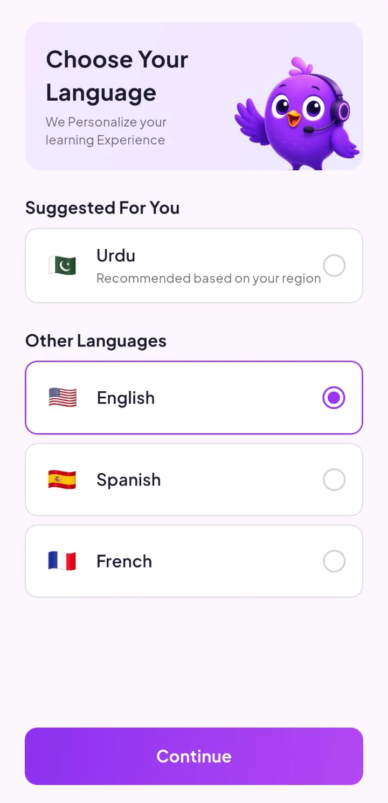 <b>Language choice</b> App UI language and regional suggestion</td>
    <td align="center"> <b>Learn hub</b> CEFR tabs, XP, vocabulary, grammar, reading, saved words</td>
    <td align="center">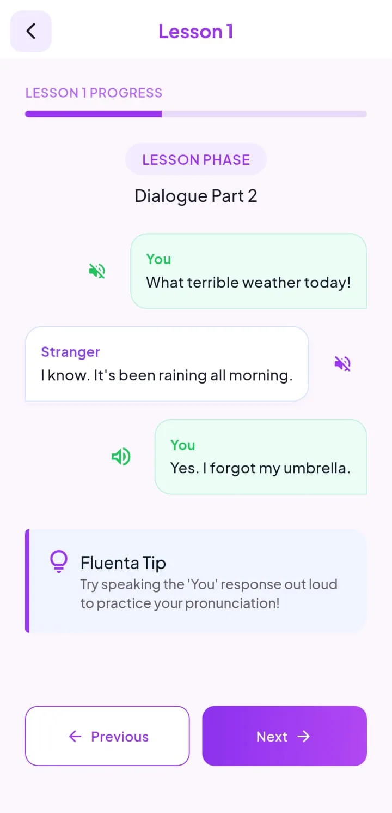 <b>Lesson dialogue</b> Scripted chat lines with listen controls and a speak-aloud tip</td>
  </tr>
</table>

### 2. Roleplay (bundled, not generative)

<table>
  <tr>
    <td align="center"> <b>Scenario hub</b> Dialogue, vocabulary and comprehension entry points</td>
    <td align="center">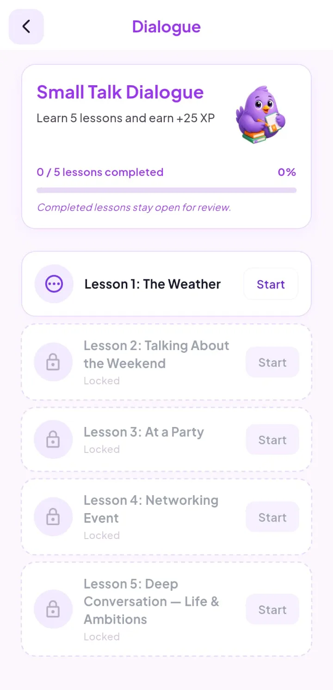 <b>Dialogue lesson list</b> Sequential unlock; completed lessons stay reviewable</td>
  </tr>
</table>

Roleplay conversations, quizzes and vocabulary lists ship as assets. They do not call the language-model API.

### 3. AI pronunciation and chat

<table>
  <tr>
    <td align="center"> <b>Pronunciation start</b> Target phrase, Listen, heart cost label</td>
    <td align="center">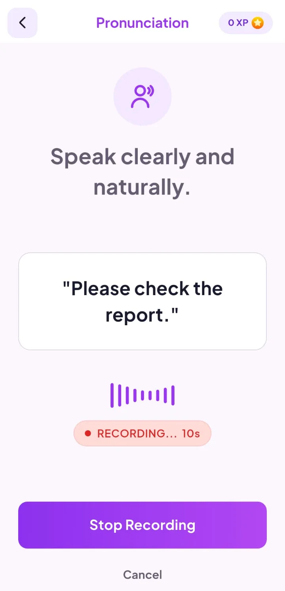 <b>Recording</b> Amplitude meter and stop control</td>
  </tr>
</table>

Open chat is not pictured in this gallery; it supports typed messages, hold-to-speak with cloud transcription, optional auto-read replies, quick topic starters, and at most one correction block per turn.

  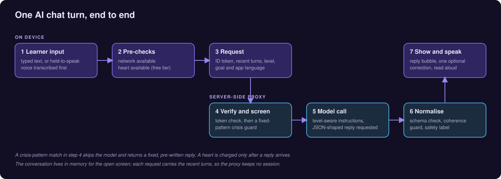

## Free and Pro (conceptual)

| Area | Free (typical) | Pro (gated in app) |
|---|---|---|
| Core A1–B1 lesson paths | Included | Included |
| B2+ lesson paths | Locked | Unlocked |
| Roleplay scenarios | Subset | All scenarios |
| Open AI chat and pronunciation | Heart-limited | Unlimited hearts |
| Weekly progress report screen | Locked | Unlocked (aggregated on-device stats) |
| Ads | Shown on free tier | Suppressed for subscribers |

Exact limits and prices live in the shipping app and stores, not in this repository.

## Engineering Highlights

### Curriculum without a CMS
- **Problem:** Hundreds of structured lessons and roleplay branches need to ship offline, version with the app, and stay parseable on low-end phones.
- **Approach:** JSON manifests and per-lesson assets in the Flutter bundle; repositories load by CEFR level and type; progress bitmaps and XP live in SharedPreferences with Firestore merge for signed-in users.
- **Outcome:** Vocabulary, grammar, reading and roleplay work without network access; only AI, sync and billing need connectivity.

### AI keys stay off the device
- **Problem:** Chat, transcription, translation and pronunciation all need paid third-party APIs; embedding credentials in a mobile binary is not acceptable.
- **Approach:** Four HTTPS Cloud Functions verify the Firebase ID token on every request, run deterministic crisis-pattern handling before chat model calls, and hold the provider secret in the function environment.
- **Outcome:** The app sends only user content and session context; the proxy is the sole API client.

### Pronunciation scored in code, not by opinion
- **Problem:** Asking a language model whether pronunciation "sounds right" is inconsistent and can leak the target phrase into transcription prompts.
- **Approach:** The server transcribes audio without the expected phrase, aligns words with deterministic scoring (edit distance, token confidence when available), and returns structured per-word results plus a short coaching line in the learner's app language.
- **Outcome:** Scores are reproducible from the transcript alignment; the UI can show word-level highlights.

### Hearts charged only after success
- **Problem:** Mobile networks drop; users should not lose currency to timeouts.
- **Approach:** Chat and pronunciation deduct a heart only after a successful proxy response; timeout and error paths restore or never charge; Pro bypasses the ledger entirely.
- **Outcome:** Predictable UX on flaky networks. Server-side heart enforcement would be a natural next step for abuse resistance.

### Chat sessions that stay on the phone
- **Problem:** Long-lived chat logs in the cloud raise retention questions; learners still need multi-turn context within a sitting.
- **Approach:** Messages for open chat live in memory for the screen session; each request sends a bounded slice of recent turns plus setup fields (self-reported level, learning goal, app language code). A generated conversation id correlates analytics events only.
- **Outcome:** Multi-turn tutoring without a separate chat database. Leaving the screen ends the session.

More trade-offs and limits: [docs/ENGINEERING_CHALLENGES.md](docs/ENGINEERING_CHALLENGES.md).

## Architecture

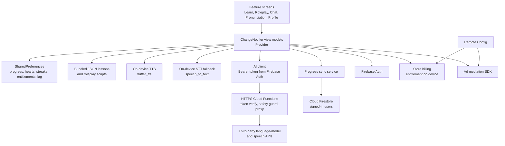

Deeper diagrams and data categories: [docs/ARCHITECTURE.md](docs/ARCHITECTURE.md).

## Technology Stack

| Layer | Technology |
|---|---|
| App framework | Flutter / Dart |
| State | Provider (`ChangeNotifier` view models) |
| Local persistence | SharedPreferences for progress, hearts, settings |
| Cloud data | Cloud Firestore for profile and learning stats when signed in |
| Auth | Firebase Auth (email/password, Google, Apple) |
| AI transport | `http` client posting JSON to Cloud Functions with ID token |
| Speech output | `flutter_tts` with segmented English vs app-language voices |
| Speech input | `record` for WAV capture; cloud transcription primary; `speech_to_text` fallback |
| Monetisation | `in_app_purchase`, Google Mobile Ads, Remote Config |
| Engagement | Firebase Analytics, Messaging, local notifications |
| Server | Node.js Cloud Functions (chat, transcribe, assess pronunciation, translate vocabulary) |

## Documentation

| Document | Contents |
|---|---|
| [docs/PRODUCT_OVERVIEW.md](docs/PRODUCT_OVERVIEW.md) | Feature map, learner flows, what is AI vs bundled |
| [docs/TECHNICAL_CASE_STUDY.md](docs/TECHNICAL_CASE_STUDY.md) | End-to-end case studies for chat, pronunciation and sync |
| [docs/ARCHITECTURE.md](docs/ARCHITECTURE.md) | Layers, persistence, proxy contracts (conceptual) |
| [docs/ENGINEERING_CHALLENGES.md](docs/ENGINEERING_CHALLENGES.md) | Trade-offs, test coverage, known limits |
| [docs/PRIVACY_AND_SOURCE.md](docs/PRIVACY_AND_SOURCE.md) | What this repo includes, data categories sent to backends |

## Private Source

Production source, Firebase rules, function secrets, store product identifiers, ad unit identifiers and tuning constants are not published here. For access discussions, see [docs/PRIVACY_AND_SOURCE.md](docs/PRIVACY_AND_SOURCE.md).
