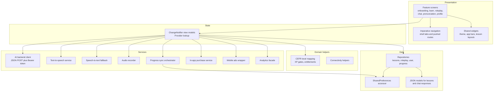
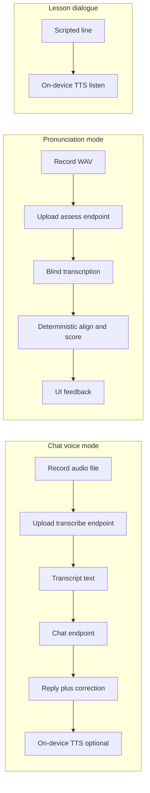

# Architecture

Diagrams in this document are original and conceptual. Labels describe responsibilities, not production class names, routes or collection identifiers.

## 1. System overview

  

The mobile client contains the full lesson corpus. Firebase provides identity, optional cloud profile and stats, messaging, analytics and remote toggles. A small set of HTTPS Cloud Functions forms the only bridge to paid language-model and speech APIs.

## 2. Client layers

| Layer | Responsibility |
|---|---|
| **Presentation** | Material screens per feature area; large lesson layouts shared across vocabulary, grammar and reading |
| **State** | View models extend `ChangeNotifier`; widgets call `context.watch` or `read` for services |
| **Domain helpers** | Pure functions for CEFR ordering, XP unlock tables, entitlement checks without I/O |
| **Data** | Repositories load bundled assets via root bundle, parse manifests, persist completion bitsets locally |
| **Services** | Side-effecting adapters (HTTP, TTS, billing, ads, analytics) injected through `Provider` at app root |

## 3. Serverless AI proxy

Four HTTPS functions (region configured in the client constants package) expose POST endpoints:

| Endpoint role | Request body (conceptual) | Response (conceptual) |
|---|---|---|
| **Tutor chat** | User text, recent turn history, optional level, goal, language code | Tutor reply text, optional correction triplet, boolean correctness flag |
| **Transcribe speech** | Base64 audio, mime type, filename | Transcript string |
| **Assess pronunciation** | Base64 audio, mime type, filename, expected phrase, optional feedback language | Scores, per-word breakdown, coaching tip, scoring method marker |
| **Translate vocabulary** | English meaning and example, target language code | Translated meaning and example |

Common middleware on each function:

- CORS enabled for mobile clients.
- `Authorization: Bearer` Firebase ID token verified with Admin SDK.
- Provider API key read from environment secrets (never shipped to clients).
- Timeouts sized for speech upload (roughly one minute class).

Chat-specific server modules also:

- Trim history to a bounded number of turns before calling the model.
- Apply deterministic crisis detection prior to provider calls.
- Request JSON-shaped model output and parse defensively before returning to the app.

Pronunciation-specific server modules:

- Reject empty or oversized payloads.
- Transcribe with a model chosen for literal phonetic output.
- Score exclusively in JavaScript using transcript alignment (see functions test file in production).

## 4. Persistence model

### On device

SharedPreferences stores scalar and JSON-encoded structures:

- Onboarding and setup completion flags.
- Selected app language and theme.
- English goal and self-reported level ids.
- Aggregated stats (XP, streak, hearts, daily goal progress).
- Serialized lesson progress maps and roleplay completion markers.
- Premium boolean and last known subscription product reference.
- Ad frequency counters and tutorial completion.

Lesson content itself is not duplicated into preferences; only progress bits and counters are stored.

### Cloud (signed-in users)

Firestore holds a per-user document merged on login:

- Profile fields (display name, email, language, goal, level, setup flags).
- Learning aggregates mirrored from local stats services.
- Heart count for cross-device consistency.
- Daily goal configuration and progress snapshots.

Chat transcripts are not part of this document model.

### Sync strategy

Writes originate locally during gameplay; a sync service debounces heart updates and pushes stat deltas after lesson completion. Login pulls remote setup before clobbering local onboarding answers, reducing reinstall data loss.

## 5. Speech pipeline comparison

| Feature | Capture | Cloud speech API | On-device STT | On-device TTS |
|---|---|---|---|---|
| Lesson dialogue listen | n/a | No | No | Yes |
| Chat voice input | Yes | Transcribe endpoint | Fallback if record fails | Optional reply playback |
| Pronunciation | Yes | Assess endpoint (transcribe inside) | Parallel optional | Phrase model playback |

## 6. Security and trust boundaries

| Trust boundary | What crosses it |
|---|---|
| Device to Firebase Auth | Email/password or OAuth tokens; ID tokens refreshed for AI calls |
| Device to Cloud Functions | JSON payloads described above plus Bearer token |
| Functions to provider | Provider secret, model requests, audio bytes |
| Device to Firestore | Profile and stats fields under authenticated Firebase rules (rules not published here) |

The app does not implement certificate pinning in the described client; it relies on platform TLS stacks.

## 7. Observability

Firebase Analytics receives a typed event catalogue (chat submitted, chat reply, pronunciation recording milestones, heart gate hits, lesson completions, and others) with parameter keys for conversation id, sequence, heart balances, and error classes. Crashlytics and Performance Monitoring libraries are linked for production signal.

Remote Config toggles ad placements and paywall experiments without shipping a new binary.

## 8. Related documents

- Product-facing feature map: [PRODUCT_OVERVIEW.md](PRODUCT_OVERVIEW.md)
- Narrative walkthroughs: [TECHNICAL_CASE_STUDY.md](TECHNICAL_CASE_STUDY.md)
- Trade-offs: [ENGINEERING_CHALLENGES.md](ENGINEERING_CHALLENGES.md)
